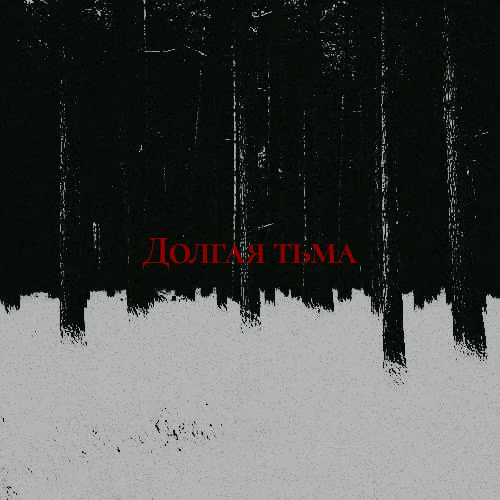

<h1 align="center">Истории · <em>ron1nz</em></h1>
<p align="center">Авторские рассказы со звуковым оформлением для Windows и Android</p>
<p align="center"></p>
<p align="center"><strong>«Долгая тьма» · Том I · Первые три главы</strong></p>

Перед Новым годом Денис и его друзья отправляются в Сибирь. Впереди — горы, снег и несколько дней в поезде. Но одна остановка меняет всё. И зимний лес оказывается гораздо ближе, чем хотелось бы.

**18+** · Мистика и психологический хоррор. В рассказе есть ненормативная лексика и сцены насилия. Звуковое оформление включает внезапные эффекты.

## Скачать 1.9.2

| Платформа | Файл | Требования |
| --- | --- | --- |
| Windows | [Установщик EXE](https://github.com/ron1nz-code/ron1nz-stories/releases/download/v1.9.2/Ron1nzStories-Setup-1.9.2.exe) | Windows 10 или 11 x64, .NET Framework 4.8 и Microsoft Edge WebView2 Runtime |
| Android | [Подписанный APK](https://github.com/ron1nz-code/ron1nz-stories/releases/download/v1.9.2/Ron1nzStories-Android-1.9.2.apk) | Android 8.0 или новее, актуальный Android System WebView |
| Исходный код | [Архив ZIP](https://github.com/ron1nz-code/ron1nz-stories/releases/download/v1.9.2/Ron1nzStories-Source-1.9.2.zip) | Инструкции по сборке ниже |

В Windows пользовательское соглашение открывается в установщике. После установки приложение сразу открывает библиотеку. EXE не имеет цифровой подписи издателя.

APK обновляет версии 1.3–1.9.1 ветки `com.ron1nz.stories.reader` с сохранением прогресса, закладок и настроек. На Android соглашение появляется, если принятие ещё не сохранено на устройстве.

## Чтение

- Атмосферный фон и звуковые эффекты меняются по мере чтения. Звук, эффекты и анимацию можно отключить.
- Оглавление, поиск по трём главам и закладки помогают вернуться к нужному месту. Позиция чтения сохраняется автоматически.
- Размер текста, шрифт, ширина строки, межстрочный интервал и тёмная тема настраиваются.
- Текст, иллюстрации и звуки доступны офлайн. Настройки и прогресс хранятся на устройстве.

## Сборка

Для локального просмотра запустите `node scripts/serve.cjs` и откройте `http://127.0.0.1:4173/`. Команда `node scripts/verify.cjs` проверяет текст по экспорту Notion, наличие ресурсов и синтаксис. Остальные проверки находятся в `scripts/test-*.cjs`.

```powershell
# Windows: распакованный NuGet Microsoft.Web.WebView2 1.0.4314.35
./scripts/build-windows.ps1 -WebViewPackage '<папка WebView2>' -OutputDirectory 'release'

# Android: SDK Platform 36, Build Tools 36, JDK 17+
./scripts/build-android.ps1 -AndroidSdk '<SDK>' -JavaHome '<JDK>' -SigningDirectory '<папка ключа>' -OutputDirectory 'release'
```

`dist/` содержит интерфейс и готовые ресурсы, `native/` — оболочки Windows и Android, `content/` — экспорт текста. Для подписи обновлений Android нужен исходный ключ приложения. Закрытый ключ и пароль хранятся отдельно от репозитория.

## Автор и материалы

Рассказ и обложка — **_ron1nz_**. [Сайт автора](https://ron1nz.ru)

[Изменения в 1.9.2](CHANGES-1.9.2.md) · [Пользовательское соглашение](EULA.txt) · [Авторы звуков и лицензии](dist/assets/Audio-LICENSES.txt)
